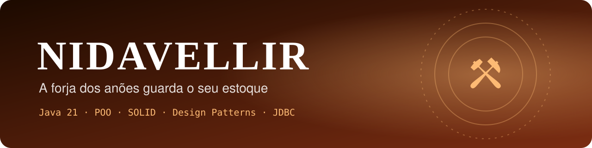
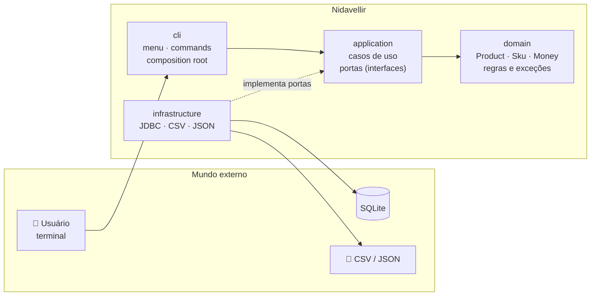
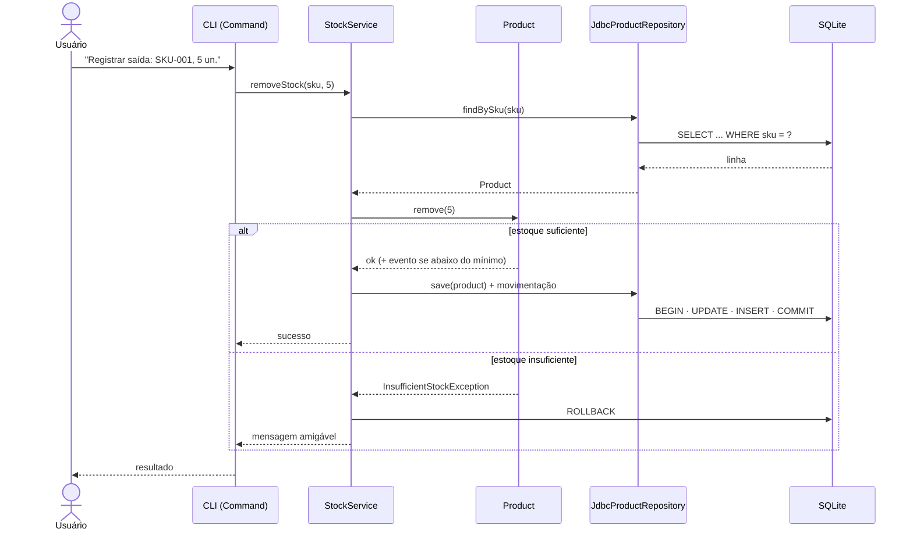
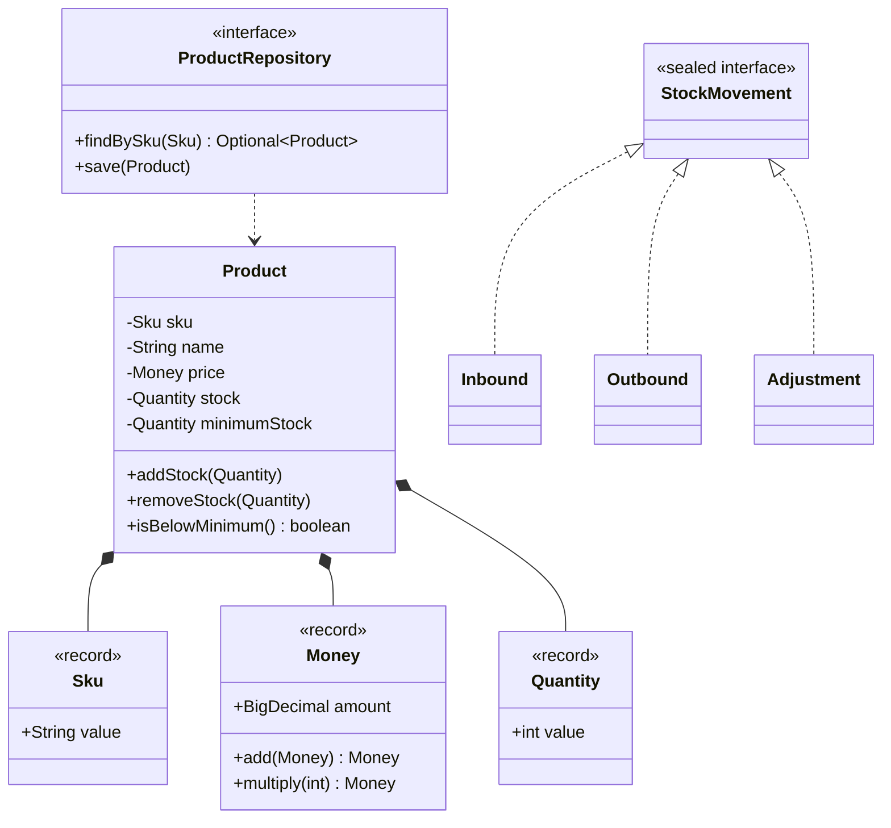

<div align="center">



# ⚒ Nidavellir
### A forja dos anões guarda o seu estoque

**Controle de estoque em linha de comando, escrito em Java 21 puro.**
Sem frameworks: só a linguagem, orientação a objetos bem feita, design patterns,<br/>
JDBC com transações e testes automatizados. A base antes do Spring.

[](https://github.com/GustavoThe01/nidavellir-inventory/actions/workflows/ci.yml)


</div>

---

## 👨‍💻 Autor

<table>
  <tr>
    <td width="62%">

Eu sou o **Gustavo Osterno Thé**, e o **Nidavellir** é um dos cinco projetos do meu portfólio público de Desenvolvedor Pleno. Idealizei, desenvolvo e mantenho este repositório.

Com ele quero mostrar domínio de **Java e de orientação a objetos sem a ajuda de frameworks**. Tudo o que o Spring faria "por mágica" (injeção de dependência, transações, repositórios), aqui eu faço à mão, de forma explícita e testada.

    </td>
    <td width="38%">

| | |
|---|---|
| 🌐 Site | [site-gustavothe-dev.web.app](https://site-gustavothe-dev.web.app/) |
| 💼 LinkedIn | [gustavoosterno](https://www.linkedin.com/in/gustavoosterno/) |
| 🐙 GitHub | [@GustavoThe01](https://github.com/GustavoThe01) |
| 📸 Instagram | [@gustavo.osterno](https://www.instagram.com/gustavo.osterno) |

    </td>
  </tr>
</table>

---

## 📑 Sumário

- [Em números](#-em-números)
- [A origem do nome](#-a-origem-do-nome)
- [O que o sistema faz](#-o-que-o-sistema-faz)
- [Arquitetura](#️-arquitetura)
- [Modelo de domínio](#-modelo-de-domínio)
- [Design patterns aplicados](#-design-patterns-aplicados)
- [Competências demonstradas](#-competências-demonstradas)
- [Metodologias e decisões](#-metodologias-e-decisões)
- [Roadmap](#️-roadmap)
- [Como rodar](#-como-rodar)
- [Testes](#-testes)
- [Estrutura do projeto](#-estrutura-do-projeto)
- [O que ainda falta](#-o-que-ainda-falta)
- [Projetos relacionados](#-projetos-relacionados)

---

## 📊 Em números

<div align="center">

| ☕ Linguagem | 🧱 Design | 🧪 Qualidade | 🗓️ Processo |
|:---:|:---:|:---:|:---:|
| **Java 21** LTS, zero frameworks | **6** design patterns planejados | meta de **80%** de cobertura no domínio | **10** dias de roadmap |
| `record`, `sealed`, pattern matching | **4** camadas com regra de dependência | JUnit 6 · AssertJ · Mockito | **1** ADR registrado |
| virtual threads | SOLID do começo ao fim | CI a cada push | Conventional Commits |

<sub>Metas para o fim do roadmap. O estado atual está nos badges, na seção <a href="#-testes">Testes</a> e em <a href="#-o-que-ainda-falta">O que ainda falta</a>.</sub>

</div>

---

## ⚒ A origem do nome

> *Na mitologia nórdica, Nidavellir ("campos escuros") é a morada dos anões, os grandes ferreiros dos Nove Mundos.*

Foram anões ferreiros que forjaram tesouros como o martelo de Thor, o Mjölnir, e o anel de Odin, o Draupnir. Gosto de imaginar essas forjas como o primeiro almoxarifado da história: cada peça feita, contada e guardada. Por isso escolhi o nome. O Nidavellir é um sistema de estoque em que cada item tem origem, quantidade e histórico, e nada entra ou sai sem registro.

---

## ✨ O que o sistema faz

| Módulo | O que resolve |
|---|---|
| 📦 **Produtos** | Cadastro com SKU único, categoria, preço (`BigDecimal`) e estoque mínimo |
| 🔄 **Movimentações** | Entradas, saídas e ajustes, sempre com histórico e dentro de transação |
| 🚨 **Alertas** | Aviso automático quando um produto fica abaixo do estoque mínimo (Observer) |
| 💲 **Precificação** | Políticas de preço e desconto intercambiáveis (Strategy) |
| 📊 **Relatórios** | Valor total em estoque, produtos por categoria, curva de giro (Streams) |
| 📤 **Exportação** | CSV e JSON com `java.nio` |
| 📥 **Importação em lote** | CSV grande processado em paralelo, com relatório de linhas inválidas |
| 🖥️ **CLI** | Menu interativo, cada opção é um `Command` |

---

## 🏛️ Arquitetura

Dividi o código em quatro camadas, e **as dependências sempre apontam para dentro**: o domínio não conhece banco, console nem arquivo. Registrei essa decisão no [ADR 0001](docs/adr/0001-arquitetura-em-camadas.md).



### Fluxo de uma saída de estoque



---

## 🧬 Modelo de domínio



> 💡 **Por que `BigDecimal` para dinheiro?** `double` não representa valores como `0.1` com exatidão. `0.1 + 0.2` dá `0.30000000000000004`, um erro inaceitável em estoque e preço.

---

## 🧩 Design patterns aplicados

| Padrão | Onde | Por quê |
|---|---|---|
| **Repository** | `ProductRepository` | Isola persistência; troca memória ↔ JDBC sem mexer nos casos de uso |
| **Strategy** | Políticas de preço/desconto | Novas regras sem alterar código existente (OCP) |
| **Observer** | Alerta de estoque mínimo | Desacopla a regra de quem precisa ser avisado |
| **Builder** | Criação de `Product` | Objetos válidos com muitos campos opcionais |
| **Factory** | Criação de movimentações | Centraliza a escolha do tipo correto |
| **Command** | Opções do menu CLI | Cada ação é isolada, testável e fácil de adicionar |

---

## 🧠 Competências demonstradas

| Área | Conceitos |
|---|---|
| **POO** | Encapsulamento, invariantes, composição vs. herança, `equals/hashCode` |
| **SOLID** | SRP, OCP, LSP, ISP e principalmente **DIP** (portas e adaptadores) |
| **Java moderno** | `record`, `sealed interface`, pattern matching em `switch`, `Optional`, text blocks |
| **Collections & Streams** | `List/Set/Map`, `groupingBy`, `partitioningBy`, `Collectors` |
| **JDBC** | `PreparedStatement`, try-with-resources, `setAutoCommit(false)`, commit/rollback |
| **Concorrência** | `ExecutorService`, virtual threads, thread-safety |
| **I/O** | `java.nio.file.Files`, CSV, JSON |
| **Testes** | TDD no domínio, mocks com Mockito, testes de integração com banco temporário |
| **Build & CI** | Maven Wrapper, JaCoCo, Spotless, GitHub Actions, jar executável |

---

## 🧭 Metodologias e decisões

- **TDD no domínio** — escrevo o teste antes da regra.
- **Roadmap diário público** — avanço um dia de cada vez e registro tudo no [ROADMAP.md](ROADMAP.md).
- **Conventional Commits** e **versionamento semântico** com tags.
- **ADRs** — registro cada decisão estrutural com contexto e alternativas.

| ADR | Decisão | Status |
|---|---|---|
| [0001](docs/adr/0001-arquitetura-em-camadas.md) | Arquitetura em camadas com regra de dependência | ✅ Aceita |

---

## 🗺️ Roadmap

| Semana | Dias | Tema | Progresso |
|---|---|---|---|
| 1 | 01–05 | Fundação, domínio, Streams, JDBC + SQLite, transações | 🟧⬜⬜⬜⬜ |
| 2 | 06–10 | Design patterns, CLI, Java moderno, importação paralela, qualidade e release | ⬜⬜⬜⬜⬜ |

Detalhes no [ROADMAP.md](ROADMAP.md) · Mudanças no [CHANGELOG.md](CHANGELOG.md).

---

## 🚀 Como rodar

**Pré-requisito:** JDK 21 ([Temurin](https://adoptium.net/)). O Maven **não** precisa estar instalado: o projeto usa o Maven Wrapper.

```bash
git clone https://github.com/GustavoThe01/nidavellir-inventory.git
```

```bash
cd nidavellir-inventory
```

Compilar e rodar os testes (Linux/macOS/Git Bash):

```bash
./mvnw verify
```

No Windows (PowerShell/CMD):

```bash
mvnw.cmd verify
```

Executar a aplicação:

```bash
java -cp target/classes dev.gustavo.nidavellir.cli.NidavellirApp
```

> 📦 A partir do Dia 10 haverá um **jar executável** na aba *Releases*: `java -jar nidavellir.jar`.

---

## 🧪 Testes

| Tipo | Ferramentas | Situação |
|---|---|---|
| Unitários (domínio) | JUnit 6 + AssertJ | 🟡 1 teste de fumaça |
| Com mocks (aplicação) | Mockito | ⏳ Dia 05 |
| Integração (JDBC) | SQLite em arquivo temporário | ⏳ Dia 05 |
| Cobertura | JaCoCo (meta ≥ 80% no domínio) | ⏳ Dia 10 |

---

## 📁 Estrutura do projeto

```
nidavellir-inventory/
├── .github/workflows/ci.yml          # ✅ build + testes a cada push
├── .mvn/wrapper/                     # ✅ Maven Wrapper
├── docs/
│   ├── adr/                          # ✅ decisões de arquitetura
│   └── assets/                       # ✅ banner e imagens
├── src/
│   ├── main/java/dev/gustavo/nidavellir/
│   │   ├── domain/                   # ⏳ Dia 02 — Product, Sku, Money, regras
│   │   ├── application/              # ⏳ Dia 03 — casos de uso e portas
│   │   ├── infrastructure/           # ⏳ Dia 04 — JDBC, CSV, JSON
│   │   └── cli/                      # ✅ NidavellirApp (menu no Dia 07)
│   └── test/java/...                 # ✅ testes
├── pom.xml
├── mvnw · mvnw.cmd
├── CHANGELOG.md
└── ROADMAP.md
```

---

## 🧩 O que ainda falta

Mantenho aqui um checklist vivo do que ainda vou incrementar neste repositório.

**Projeto**
- [ ] Value objects e entidade `Product` com testes (Dia 02)
- [ ] Repositório em memória e relatórios com Streams (Dia 03)
- [ ] Persistência JDBC + SQLite (Dia 04)
- [ ] Movimentações com transação (Dia 05)
- [ ] Strategy, Observer, Builder e Factory (Dia 06)
- [ ] Menu interativo com Command (Dia 07)
- [ ] `sealed` + pattern matching, exportação CSV/JSON (Dia 08)
- [ ] Importação paralela com virtual threads e logging (Dia 09)
- [ ] JaCoCo, Spotless, jar executável e release `v1.0.0` (Dia 10)

**README**
- [ ] GIF do menu da CLI em funcionamento
- [ ] Badge de cobertura (JaCoCo / Codecov)
- [ ] Exemplo de relatório exportado (CSV e JSON)
- [ ] Atualizar "Em números" e a tabela de testes com valores reais
- [ ] Definir e adicionar uma licença (`LICENSE`)
- [ ] Versão em inglês do README

---

## 🔗 Projetos relacionados

| Projeto | Stack | Relação |
|---|---|---|
| ☿ [Mercurium](https://github.com/GustavoThe01/mercurium-sql) | SQLite | Os mesmos fundamentos de modelagem e SQL que aplico aqui no JDBC |
| ⚒ **Nidavellir** | Java 21 | *você está aqui* |
| ⚖ [Plutus](https://github.com/GustavoThe01/plutus-ledger) | C# + Dapper | O mesmo nível de fundamento, em .NET |
| ♾ [Moirai](https://github.com/GustavoThe01/moirai-taskflow) | Spring Boot | **O par deste projeto em Java**: o que aqui faço à mão, lá fica com o framework |
| ✦ [Bifrost](https://github.com/GustavoThe01/bifrost-orders) | ASP.NET Core | API completa em .NET |

<div align="center">

<sub>Forjado por mim, com ☕ · <a href="https://github.com/GustavoThe01">Gustavo Osterno Thé</a></sub>

</div>
